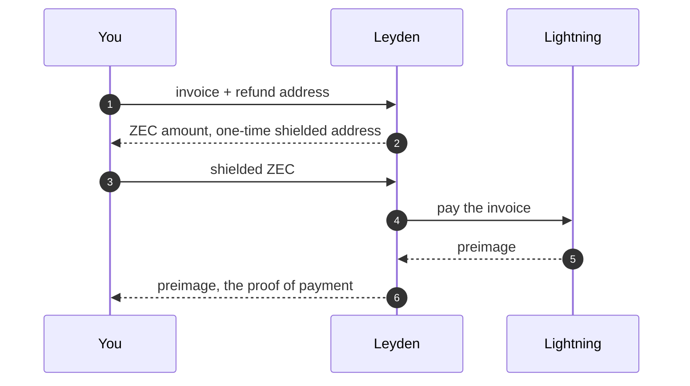
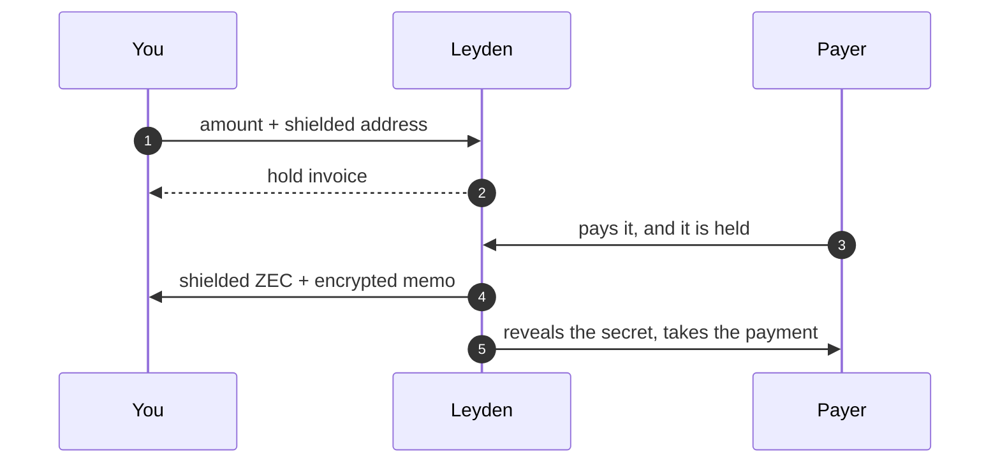
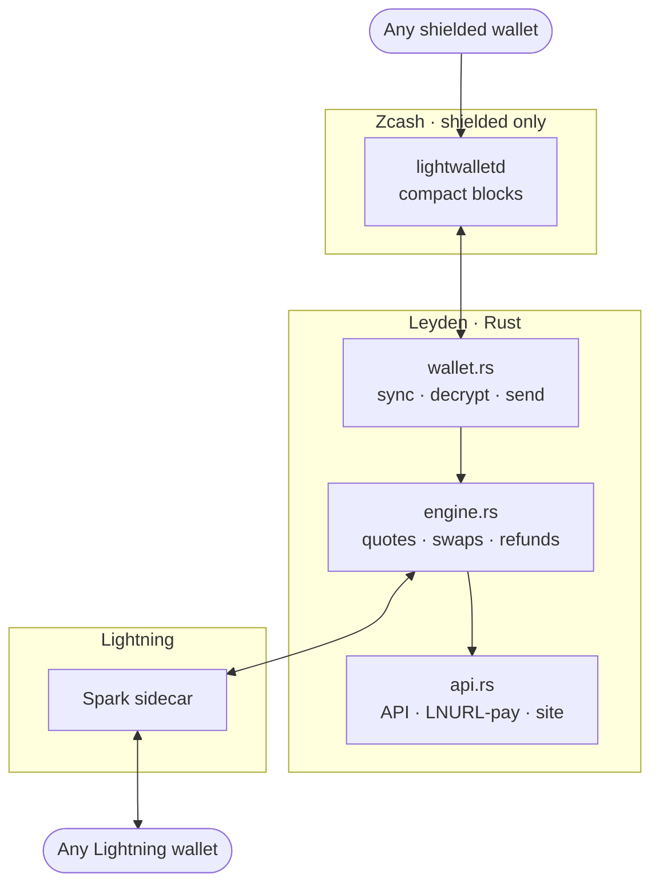

<p align="center">
  
</p>

<h1 align="center">Leyden</h1>

<p align="center"><b>Shielded ZEC, at Lightning speed.</b></p>

<p align="center">
  A gateway between the Zcash shielded pool and the Bitcoin Lightning Network.<br/>
  Pay any Lightning invoice from shielded ZEC, or get paid over Lightning <b>straight into the shielded pool</b>.
</p>

<p align="center">
  <code>0</code> transparent addresses · <code>0</code> Bitcoin transactions · about a minute · live on mainnet
</p>

<p align="center">
  <a href="https://leydenpay.xyz">Live app</a> ·
  <a href="https://leydenpay.xyz/#proof">Receipts</a> ·
  <a href="docs/mainnet-runs.md">Mainnet run log</a>
</p>

---

A Leyden jar was the first device that could hold electricity: lightning, kept sealed. Leyden
does the same for payments. Value moves between Zcash and Lightning without unshielding on the
way through, from wallets people already have. No account, nothing to connect, nothing to sign.

| | You | Leyden |
| --- | --- | --- |
| **Pay** | paste a Lightning invoice, send the quoted ZEC from any shielded wallet | pays the invoice and hands you the preimage, the proof of payment |
| **Get paid** | share an invoice for any amount | holds the payment, sends you shielded ZEC with an encrypted memo, then takes it |
| **Lightning address** | claim `you@leydenpay.xyz` | turns every payment to it into shielded ZEC; the payer's comment arrives as a memo |

The usual ZEC ⇄ BTC routes take ZEC on a transparent address or settle Bitcoin on-chain, which
publishes the amounts and links both sides. Here, a Zcash observer sees one shielded transaction
(0 inputs, 0 outputs, 0 value on the explorer) and a Bitcoin observer sees nothing at all.

## How it works

**Pay.** Every quote gets a fresh Orchard-only address. The gateway spots your payment by
scanning compact blocks itself, waits one confirmation, and pays the invoice.



If the Lightning payment fails, or you send the wrong amount, the ZEC goes back to your shielded
address on its own.

**Get paid.** The invoice is a hold invoice, locked to a secret only Leyden knows. Your payer's
sats are held, not taken, until the shielded ZEC is on its way.



If the ZEC can't be sent, Leyden never takes the payment: it stays locked until the hold expires,
then goes back to the payer.

## Why it does not leak

| Party | Learns | Never learns |
| --- | --- | --- |
| Zcash chain observers | that a shielded transaction happened | sender, recipient, amount, memo, that Lightning was involved |
| Bitcoin chain observers | nothing, Lightning is off-chain | everything |
| Lightning routing nodes | the amount passing through | who paid and who was paid |
| The payee | that their invoice was paid | your Zcash address, wallet or balance |
| The light-wallet server | that the gateway downloads every block | which transactions are the gateway's |
| **Leyden** | the invoice, the amounts, your shielded address, your IP unless you use Tor | anything else; the link between both sides is erased 24 hours after a swap |

- **One address per quote.** Diversifier index 2³² + n, so no two payments share an address and
  no memo or account is needed to match them.
- **No transaction lookups.** It syncs compact blocks and trial-decrypts locally, and never calls
  `GetTransaction`, which would tell the server which transactions it cares about.
- **Shielded only, enforced.** Transparent and TEX refund or payout addresses are refused.
- **Nothing kept, nothing logged.** Linking data is erased after 24 hours. Caddy discards every
  log, and the site loads nothing from other origins under a strict CSP.

## Trust

Leyden holds your ZEC for about a minute when you pay with it, the way an instant-swap service
does, and refunds it automatically if the payment fails. When you get paid, the hold invoice means
the payer's sats are never at risk from Leyden failing. Swaps are capped at 100–5,000 sats.

A fully trustless version isn't possible today: a shielded note can't be locked to a SHA-256
preimage, and point-locked payments aren't deployed on Lightning. So the code is open and anyone
can run their own. Lightning goes through a [Spark](https://spark.money) wallet, whose operators see
the gateway's Lightning payments but never the Zcash side.

## Live on mainnet

Six runs with real money, each Zcash transaction fully shielded. Preimages and hashes are in
[docs/mainnet-runs.md](docs/mainnet-runs.md).

| # | Run | Amount | Zcash tx |
| --- | --- | --- | --- |
| 1 | ZEC → Lightning, preimage matches the invoice | 1,000 sats | [`0c54e2b8…a004`](https://blockchair.com/zcash/transaction/0c54e2b885e9faa475d89030a7f5e28f22ab7f534d2e57e629e82cf98249a004) |
| 2 | Lightning → ZEC, with a memo | 500 sats | [`91601ee8…2c8f`](https://blockchair.com/zcash/transaction/91601ee802b41b36046aabc4d3814b00eb386931c6830aef07a22d2cbadc2c8f) |
| 3 | ZEC → Lightning, production | 1,500 sats | [`d23d08c0…62e4`](https://blockchair.com/zcash/transaction/d23d08c04902193c0d34640296d58e4954923d51df71e555a52fc89de10c62e4) |
| 4 | Lightning address, comment arrives as a memo | 600 sats | [`f2686336…b465`](https://blockchair.com/zcash/transaction/f2686336e1035405c777722f308cd573fa576a952517f9a66b740bbb6158b465) |
| 5 | Underpaid swap, refunded automatically | 0.0003 ZEC | [`d0ee5ca3…f9ed`](https://blockchair.com/zcash/transaction/d0ee5ca35bbda1e0f14493c98b238b26c69e378d0377d8fb38d4cba511dcf9ed) |
| 6 | Lightning → ZEC with a hold invoice | 500 sats | [`bae01061…3a55`](https://blockchair.com/zcash/transaction/bae01061fac67226cb2196d9170a944b1d147f864f6de724d6239bd135b93a55) |

### One payment, held

Run 6 from the gateway's side, 26 October 2026, UTC:

```
16:14:43   quote             500 sats → 0.00016837 ZEC, hold invoice issued
16:14:54   payment held      the payer's sats are locked, not taken
16:15:03   ZEC sent          shielded payout bae01061…3a55
16:15:07   payment taken     payer gets preimage 9d8f6bde…; sha256 = the invoice's hash
```

Twenty-four seconds, and at no point could the payer have lost the sats to a failed payout.

### Where to look in the code

| What | Where |
| --- | --- |
| A fresh shielded address per quote | [`wallet.rs#L178-L190`](gateway/src/wallet.rs#L178-L190), `quote_address` |
| Compact-block sync, no transaction lookups | [`wallet.rs#L164-L173`](gateway/src/wallet.rs#L164-L173), `sync` |
| Transparent addresses refused | [`wallet.rs#L349-L362`](gateway/src/wallet.rs#L349-L362), `parse_shielded_recipient` |
| The hold invoice and its secret | [`engine.rs#L135-L151`](gateway/src/engine.rs#L135-L151) |
| ZEC first, then take the payment | [`engine.rs#L328-L366`](gateway/src/engine.rs#L328-L366), `pay_out` and `settle` |
| Never pay for a payment already returned | [`engine.rs#L309-L319`](gateway/src/engine.rs#L309-L319) |
| Underpaid or failed: refund | [`engine.rs#L245-L249`](gateway/src/engine.rs#L245-L249), [`#L283-L296`](gateway/src/engine.rs#L283-L296) |
| Linking data erased after 24 h | [`store.rs#L214-L226`](gateway/src/store.rs#L214-L226), `purge_finished` |
| Lightning addresses, comments as memos | [`api.rs#L230-L252`](gateway/src/api.rs#L230-L252), LNURL-pay callback |

## Architecture

One Rust binary that runs the shielded wallet and the swaps, and a small Node sidecar that speaks
Lightning.



A swap moves through these states:

```
Pay        awaiting_zec → paying_ln → complete         or refunding → refunded
Get paid   awaiting_ln  → paying_zec → settling_ln → complete
```

<details>
<summary><b>API</b></summary>

| Method | Path | Does |
| --- | --- | --- |
| `GET` | `/api/info` | rate, fee, limits, live liquidity |
| `POST` | `/api/swaps/pay` | `{invoice, refund_address}` → a ZEC → Lightning quote |
| `POST` | `/api/swaps/receive` | `{payout_address, amount_sats, memo?}` → a Lightning → ZEC quote |
| `GET` | `/api/swaps/{id}` | a swap's state |
| `POST` / `DELETE` | `/api/ln-address` | claim `{name, payout_address}`, or delete with `{name, manage_key}` |
| `GET` | `/.well-known/lnurlp/{name}` | LNURL-pay for a Lightning address |

</details>

## Run your own

Rust 1.89+ and Node 22+.

```bash
# Lightning sidecar: a Spark wallet behind a localhost API
cd lightning && npm ci
node init-wallet.mjs ~/.leyden/spark.mnemonic      # prints an address to fund it
LEYDEN_LN_TOKEN=$(openssl rand -hex 24) LEYDEN_LN_MNEMONIC=~/.leyden/spark.mnemonic node server.mjs

# Gateway: creates its shielded wallet on first run
cd ../gateway && cargo build --release
./target/release/leyden --zec-mnemonic ~/.leyden/zec.mnemonic address    # send ZEC here for liquidity
LEYDEN_LN_TOKEN=… ./target/release/leyden --zec-mnemonic ~/.leyden/zec.mnemonic serve --web ../web
```

[`deploy/`](deploy) has the systemd units, the Caddyfile and an environment template.

<details>
<summary><b>Configuration</b></summary>

| Variable | Default | |
| --- | --- | --- |
| `LEYDEN_ZEC_MNEMONIC` | required | the gateway's Zcash seed phrase file |
| `LEYDEN_LN_TOKEN` | required | bearer token for the sidecar |
| `LEYDEN_PUBLIC_URL` | `http://localhost:8080` | its host is the Lightning-address domain |
| `LEYDEN_LWD` | `https://zec.rocks:443` | lightwalletd |
| `LEYDEN_FEE_BPS` | `100` | swap fee in basis points |
| `LEYDEN_MIN_SATS` · `LEYDEN_MAX_SATS` | `100` · `20000` | per-swap limits; the live demo uses 5,000 |
| `LEYDEN_QUOTE_TTL` | `1200` | quote lifetime in seconds |
| `LEYDEN_RETAIN_SECS` | `86400` | how long linking data of finished swaps is kept |
| `LEYDEN_DATA` · `LEYDEN_WEB` · `LEYDEN_LISTEN` | `./data` · `./web` · `127.0.0.1:8080` | paths and listener |

</details>

## Layout

| | |
| --- | --- |
| `gateway/` | the Rust gateway: shielded wallet, swap engine, API |
| `lightning/` | the Spark sidecar, plus setup and test helpers |
| `web/` | the site and app at [leydenpay.xyz](https://leydenpay.xyz), plain HTML, CSS and JS |
| `deploy/` | systemd units, Caddyfile, environment template |
| `docs/` | the mainnet run log |

## Licence

MIT. See [LICENSE](LICENSE).

---

<p align="center">
  <sub>Built for ZECATHON 2026 on librustzcash and Spark.</sub><br/>
  <sub><b>Lightning, held privately.</b></sub>
</p>
