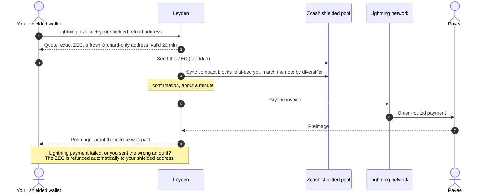
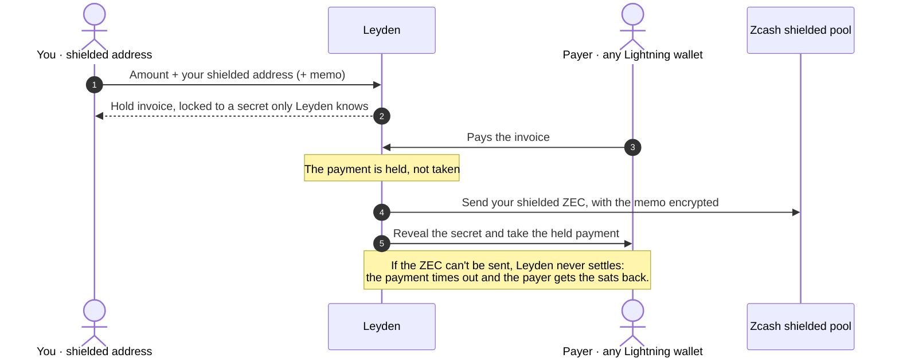
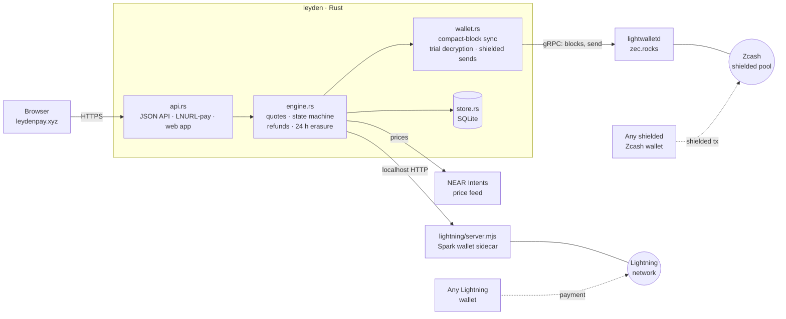
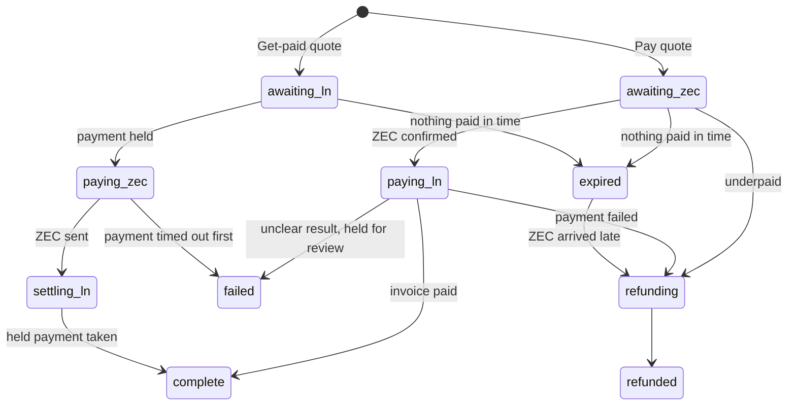

<p align="center">
  <a href="https://leydenpay.xyz">
    <picture>
      <source media="(prefers-color-scheme: dark)" srcset="docs/assets/logo-dark.png">
      
    </picture>
  </a>
</p>

<p align="center">
  <b>Shielded ZEC, at Lightning speed.</b><br>
  Pay any Lightning invoice from shielded Zcash, or get paid over Lightning straight into the shielded pool.
</p>

<p align="center">
  <a href="https://leydenpay.xyz"></a>
  
  
  <a href="LICENSE"></a>
</p>

<p align="center">
  <a href="https://leydenpay.xyz/app/">Launch the app</a> ·
  <a href="https://leydenpay.xyz/#proof">Check the receipts</a> ·
  <a href="docs/mainnet-runs.md">Mainnet run log</a>
</p>

---

Leyden is a swap gateway between the **Zcash shielded pool** and the **Bitcoin Lightning Network**. Neither leg touches a transparent address or a public Bitcoin transaction. There is no account, nothing to connect, nothing to sign: you use the wallets you already have.

| | What you do | What happens |
|---|---|---|
| **Pay** · ZEC → Lightning | Paste a Lightning invoice, send the quoted ZEC from any shielded wallet | Leyden pays the invoice and hands you the preimage, the payee's proof of payment |
| **Get paid** · Lightning → ZEC | Enter an amount and your shielded address, share the invoice | The payer's sats are held until your shielded ZEC is sent, with an encrypted memo |
| **Lightning address** | Claim `you@leydenpay.xyz` | Anyone can pay it from any Lightning wallet; it lands as shielded ZEC, and their comment arrives as an encrypted memo |

The name comes from the **Leyden jar**, the first device that could hold electricity: lightning, kept sealed.

## Why

Lightning is where Bitcoin is actually spent: far more merchants and wallets take it than take shielded ZEC. But the usual ZEC ⇄ BTC routes (exchanges, NEAR Intents, instant-swap services) take ZEC deposits on **transparent** addresses or settle BTC **on-chain**, which publishes amounts and links both sides. The site's [Privacy section](https://leydenpay.xyz/#privacy) shows exactly that, with real transactions.

With Leyden, a Zcash observer sees one shielded transaction (0 inputs, 0 outputs, 0 value on the explorer) and a Bitcoin observer sees nothing at all.

## How it works

### Pay a Lightning invoice with shielded ZEC



### Get paid over Lightning, as shielded ZEC



A Lightning address does the same thing over [LNURL-pay](https://github.com/lnurl/luds): the payer's wallet asks for an invoice, and their comment becomes the encrypted memo.

## Privacy

| Party | Learns | Never learns |
|---|---|---|
| Zcash chain observers | That a shielded transaction happened | Sender, recipient, amount, memo, that Lightning was involved |
| Bitcoin chain observers | Nothing: Lightning payments are off-chain | Everything about the payment |
| Lightning routing nodes | The amount passing through them | Who paid and who was paid (onion routing) |
| The payee | That their invoice was paid | Your Zcash address, wallet or balance |
| The light-wallet server | That the gateway downloads every block | Which transactions are the gateway's |
| **Leyden itself** | The invoice, the amounts and your shielded address while a swap runs; your IP unless you use Tor | Your other transactions or balance. The link between both sides is erased 24 h after the swap |

How that holds:

- **A fresh address for every quote.** Each ZEC → Lightning quote gets its own Orchard-only diversified address (diversifier index 2³² + n). Payments are matched by diversifier, so there's no memo, no account, and no two payments share an address.
- **No transaction lookups.** The gateway syncs compact blocks and trial-decrypts locally (`zcash_client_backend`). It never calls `GetTransaction`, the request that would tell the light-wallet server which transactions it cares about.
- **Shielded only, enforced.** Refund and payout addresses need an Orchard or Sapling receiver; transparent and TEX addresses are refused.
- **Linking data is erased.** 24 hours after a swap finishes, the invoice, addresses, txids and preimage are wiped. Amount, direction, state and time remain.
- **No logs, no third parties.** Caddy discards every log, error logs included, since they carry IPs. The web app loads nothing from other origins (fonts, QR code and animation libraries are self-hosted) under a strict Content-Security-Policy.

## Trust model

- **Getting paid uses hold invoices.** The payer's sats are held, not taken, until the shielded ZEC has been sent. If the payout fails (no liquidity, a crash, a bug), Leyden never settles and the sats return to the payer automatically. This protects against the gateway *failing*; it can't stop a gateway that settles without paying out.
- **Paying with ZEC is custodial for about a minute,** like any instant-swap service: Leyden holds your ZEC between "confirmed" and "invoice paid". Failed payments and wrong amounts are refunded automatically, minus the Zcash network fee.
- **Exposure is capped:** 100–5,000 sats per swap on the live demo, and state is persisted before any payment is sent, so a crash can never pay twice.
- **Why not fully trustless?** A shielded Zcash note can't be locked to a SHA-256 preimage, and point-locked (PTLC) payments aren't deployed on Lightning, so an atomic swap against standard invoices isn't possible today. The mitigation is that anyone can run their own gateway.
- **Lightning runs through a [Spark](https://spark.money) wallet** (no channels, no liquidity purchase), so Spark's operators see the gateway's Lightning payments, never the Zcash side. The sidecar is small and replaceable with phoenixd or LND.
- **Limits follow liquidity.** Each swap is paid from the gateway's own balance on the other side, so the maximum size moves with what it holds; the app shows the live limit.

## Proof on mainnet

Every flow has run on Zcash and Lightning mainnet with real money. Details, preimages and hashes: [docs/mainnet-runs.md](docs/mainnet-runs.md). Each Zcash transaction below shows 0 inputs, 0 outputs, 0 value on the explorer.

| # | Flow | Amount | Zcash transaction |
|---|---|---|---|
| 1 | ZEC → Lightning, preimage matches the invoice | 1,000 sats for 0.00067778 ZEC | [`0c54e2b8…a004`](https://blockchair.com/zcash/transaction/0c54e2b885e9faa475d89030a7f5e28f22ab7f534d2e57e629e82cf98249a004) |
| 2 | Lightning → ZEC, with a memo | 500 sats → 0.00017883 ZEC | [`91601ee8…2c8f`](https://blockchair.com/zcash/transaction/91601ee802b41b36046aabc4d3814b00eb386931c6830aef07a22d2cbadc2c8f) |
| 3 | ZEC → Lightning, production | 1,500 sats for 0.00101257 ZEC | [`d23d08c0…62e4`](https://blockchair.com/zcash/transaction/d23d08c04902193c0d34640296d58e4954923d51df71e555a52fc89de10c62e4) |
| 4 | Lightning address, comment as memo | 600 sats → 0.00024321 ZEC | [`f2686336…b465`](https://blockchair.com/zcash/transaction/f2686336e1035405c777722f308cd573fa576a952517f9a66b740bbb6158b465) |
| 5 | Underpaid swap, refunded automatically | 0.0003 ZEC in, 0.00015 back | [`d0ee5ca3…f9ed`](https://blockchair.com/zcash/transaction/d0ee5ca35bbda1e0f14493c98b238b26c69e378d0377d8fb38d4cba511dcf9ed) |
| 6 | Lightning → ZEC with a hold invoice | 500 sats → 0.00016837 ZEC | [`bae01061…3a55`](https://blockchair.com/zcash/transaction/bae01061fac67226cb2196d9170a944b1d147f864f6de724d6239bd135b93a55) |

The landing page's [Proof section](https://leydenpay.xyz/#proof) lets you check the Lightning preimages yourself: your browser reads the payment hash out of the invoice and hashes the preimage, nothing sent anywhere.

## Architecture



### Swap lifecycle



### API

| Method | Path | Does |
|---|---|---|
| `GET` | `/api/info` | Rate, fee, limits, live liquidity, Lightning-address domain |
| `POST` | `/api/swaps/pay` | `{invoice, refund_address}` → a ZEC → Lightning quote |
| `POST` | `/api/swaps/receive` | `{payout_address, amount_sats, memo?}` → a Lightning → ZEC quote with a hold invoice |
| `GET` | `/api/swaps/{id}` | A swap's state |
| `POST` / `DELETE` | `/api/ln-address` | Claim `{name, payout_address}` (returns a manage key) / delete `{name, manage_key}` |
| `GET` | `/.well-known/lnurlp/{name}` | LNURL-pay for a Lightning address (comments up to 200 chars) |

## Run your own

Requirements: Rust 1.89+, Node 22+.

```sh
git clone https://github.com/wildanrhmn/leyden && cd leyden

# 1. Lightning sidecar: a Spark wallet behind a localhost-only HTTP API
cd lightning && npm ci
node init-wallet.mjs ~/.leyden/spark.mnemonic        # prints a BTC deposit address to fund it
LEYDEN_LN_TOKEN=$(openssl rand -hex 24) LEYDEN_LN_MNEMONIC=~/.leyden/spark.mnemonic node server.mjs

# 2. Gateway: creates its shielded ZEC wallet on first run
cd ../gateway && cargo build --release
./target/release/leyden --zec-mnemonic ~/.leyden/zec.mnemonic address   # send ZEC here to add liquidity
./target/release/leyden --zec-mnemonic ~/.leyden/zec.mnemonic status    # sync and show the wallet
LEYDEN_LN_TOKEN=… ./target/release/leyden --zec-mnemonic ~/.leyden/zec.mnemonic serve --web ../web
```

For a server, [`deploy/`](deploy) has the systemd units, the Caddyfile (HTTPS, no logs, CSP) and an environment template.

<details>
<summary><b>Configuration</b></summary>

Every flag can also be set from the environment.

| Variable | Default | Meaning |
|---|---|---|
| `LEYDEN_DATA` | `./data` | Wallet and swap database directory |
| `LEYDEN_ZEC_MNEMONIC` | required | File holding the gateway's Zcash seed phrase |
| `LEYDEN_LWD` | `https://zec.rocks:443` | lightwalletd server |
| `LEYDEN_LISTEN` | `127.0.0.1:8080` | Gateway HTTP listener |
| `LEYDEN_PUBLIC_URL` | `http://localhost:8080` | Public URL; its host is the Lightning-address domain |
| `LEYDEN_WEB` | `./web` | Static web app directory |
| `LEYDEN_LN_URL` / `LEYDEN_LN_TOKEN` | `http://127.0.0.1:9737` / required | Lightning sidecar and its bearer token |
| `LEYDEN_FEE_BPS` | `100` | Swap fee, in basis points |
| `LEYDEN_MIN_SATS` / `LEYDEN_MAX_SATS` | `100` / `20000` | Per-swap limits (the live demo uses 5,000) |
| `LEYDEN_QUOTE_TTL` | `1200` | Quote lifetime, seconds |
| `LEYDEN_ZEC_FEE_ZAT` | `15000` | Zcash network fee reserved per payout or refund |
| `LEYDEN_MIN_CONF` | `1` | Confirmations before acting on a deposit |
| `LEYDEN_RETAIN_SECS` | `86400` | How long linking data of finished swaps is kept |
| `LEYDEN_LN_MNEMONIC` / `LEYDEN_LN_PORT` | required / `9737` | Sidecar: Spark seed file and port |

</details>

<details>
<summary><b>Repository layout</b></summary>

```
gateway/          Rust gateway
  src/main.rs       CLI: serve, status, address, send
  src/wallet.rs     shielded wallet: sync, trial decryption, quote addresses, sends
  src/engine.rs     quotes, pricing, swap state machine, refunds, erasure
  src/store.rs      SQLite swap and Lightning-address store
  src/api.rs        JSON API, LNURL-pay, static files
  src/ln.rs         client for the Lightning sidecar
  src/price.rs      ZEC/BTC rate from the NEAR Intents token list
lightning/        Spark wallet sidecar (server.mjs) and setup and test helpers
web/              landing page and app: vanilla HTML/CSS/JS, self-hosted fonts and libraries
deploy/           systemd units, Caddyfile, environment template
docs/             mainnet run log and README assets
```

</details>

## Built for ZECATHON

Built for [ZECATHON](https://thezecathon.com) (Cross-Chain track), October 2026; all code was written during the build window. It stands on [`librustzcash`](https://github.com/zcash/librustzcash) (`zcash_client_backend`, `zcash_client_sqlite`, `zcash_keys`), the Spark SDK, `light-bolt11-decoder`, `qrcode-generator` and GSAP, and uses `zcash-devtool` as the shielded test wallet.

Everything in the demo is real: mainnet Zcash, mainnet Lightning, real funds, no mocks. The only test-only code is `lightning/customer-invoice.mjs`, a second Lightning wallet that played "some Lightning user" in the recorded runs.

[MIT License](LICENSE)
